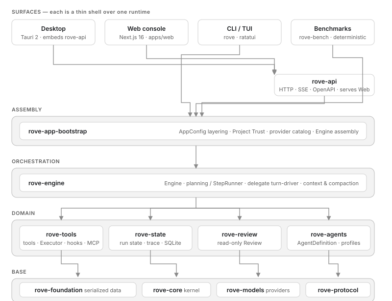

# Rove

Rove is a local-first coding agent: pick a workspace, hand it a task, watch it execute in real time, approve sensitive operations, then review files, diffs, and usage. One persistent Rust runtime (`rove-engine`) powers every surface — Desktop, Web console, CLI/TUI, HTTP API, and deterministic benchmarks share the same Engine, tool safety, and event contract. Sessions are resumable across disconnects and restarts; durable state lives in SQLite plus an append-only `trace.jsonl` per run.

This is a 0.1.0 source prerelease, suitable for local development and internal trial. Single user, single machine, no hosted service.



## Surfaces and status

| Surface | Entry | Status |
| --- | --- | --- |
| Web console | `rove-api --web-dist` or `scripts/serve.sh` / `serve.ps1` | Usable locally — acceptance runs pass on the fake model and hosted bundle; real-provider task quality not yet validated |
| CLI / TUI | `rove` (`cargo install --path apps/cli`) | Usable locally — TUI, REPL, exec, sessions, trust, review subcommands |
| HTTP API | `rove-api` | Usable locally — REST + SSE + OpenAPI (`/api/openapi.json`, `/swagger-ui`) |
| Desktop | `apps/desktop` (Tauri 2) | Works with notes — builds and runs from source; installers unsigned, installed flow not formally verified, macOS/Linux packaging unverified |
| Benchmarks | `rove-bench` | Works — deterministic, network-free |

The deterministic fake model proves orchestration and UI contracts only; it does not prove natural-language programming quality. See [docs/engineering-validation.md](docs/engineering-validation.md) and `evidence/` for the validation record.

## Quick start (30 seconds, no API key)

Requires Git and Rust stable (`rust-toolchain.toml`); the Web console also needs Node 22 and pnpm 10.

```bash
git clone https://github.com/AllureCurtain/rove.git && cd rove
cargo run -p rove-cli -- --model fake   # full-screen TUI, deterministic fake model
```

For the browser console:

```bash
cd apps/web && pnpm install --frozen-lockfile && cd ../..
bash scripts/serve.sh        # macOS/Linux; serve.ps1 on Windows
# open http://127.0.0.1:8787
```

For real providers (OpenAI/Anthropic/Ollama/OpenAI-compatible), installing `rove`, and running Desktop, see [docs/user-guide.md](docs/user-guide.md).

## Documentation

- [docs/system-overview.md](docs/system-overview.md) — 10-minute system description (start here)
- [docs/architecture.md](docs/architecture.md) — module table, data flow, state layout
- [docs/user-guide.md](docs/user-guide.md) — using each surface
- [docs/development.md](docs/development.md) — setup, commands, tests, Git process
- [docs/api.md](docs/api.md) — API conventions; spec at `/api/openapi.json`
- [docs/decisions.md](docs/decisions.md) — technical decision log
- [docs/engineering-validation.md](docs/engineering-validation.md) — validation status

## License

MIT, see [LICENSE](LICENSE).
