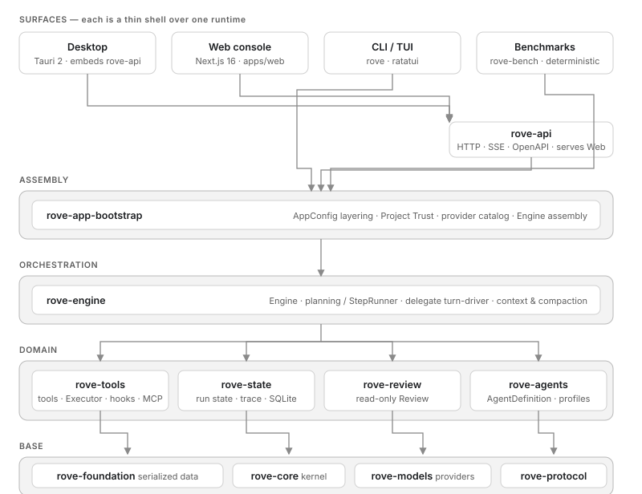

# System overview

A self-contained description of rove for a reviewer: what it is, how the parts fit, how a task executes, where state lives, and what is verified. Reading time ~10 minutes. Implementation detail lives in [architecture.md](architecture.md); user-facing behavior in [user-guide.md](user-guide.md).

## What rove is

Rove is a **local-first coding agent** for a single user on their own machine. The user picks a workspace (a repo or folder), describes a task, watches the agent work in real time, approves sensitive operations, and reviews the resulting files and diffs. Sessions survive disconnects and restarts.

The defining property is **one runtime, many surfaces**: a single persistent Rust engine (`rove-engine`) drives a Desktop app, a Web console, a CLI/TUI, an HTTP/SSE/OpenAPI API, and deterministic benchmarks. No surface owns a second agent loop; each is a shell that resolves the workspace, loads config, assembles tools and providers, and consumes events from the same Engine.

## Scope and supported surfaces

| Surface | Technology | Role |
| --- | --- | --- |
| Web console | Next.js 16 + React 19 (`apps/web`) | Graphical console: workspace → session → chat, Inspector, Settings. Served by `rove-api --web-dist` on one origin, or via a dev proxy |
| CLI / TUI | Rust, ratatui (`apps/cli`) | Full-screen agent session; also `repl`, `exec`, `review`, `sessions`, `state`, `trust`, `provider` subcommands |
| HTTP API | Axum + utoipa (`apps/api`) | REST + SSE + OpenAPI for any external client; hosts the Web bundle; embeds the runtime |
| Desktop | Tauri 2 (`apps/desktop`) | Local app embedding `rove-api` and the Web static build; native folder picker and credential entry |
| Benchmarks | `apps/bench` | Deterministic, network-free benchmark runner |

Model providers (OpenAI Chat/Responses, Anthropic, Ollama, OpenAI-compatible gateways, and a deterministic Fake model) live behind one normalized client boundary inside `rove-models`.

## Layered architecture

Dependencies flow one way, top to bottom. Each crate has a single responsibility; the authoritative module table is in [architecture.md](architecture.md#modules).

| Layer | Crate | One-line responsibility |
| --- | --- | --- |
| Assembly | `rove-app-bootstrap` | Layered `AppConfig`, Project Trust store, provider catalog, Engine assembly |
| Orchestration | `rove-engine` | `Engine`, planning and StepRunner, delegate turn-driver, context and compaction |
| Domain | `rove-tools` | Built-in tools, `Executor` pipeline, hooks, MCP client, delegation data half |
| Domain | `rove-state` | Durable run state, `trace.jsonl`, SQLite StateIndex, durable memory |
| Domain | `rove-review` | Read-only Review contracts, target snapshots, submission tools |
| Domain | `rove-agents` | `AgentDefinition` manifests, run profiles, `AGENTS.md` discovery, procedure catalog |
| Base | `rove-foundation` | Serialized identity/lifecycle data, `StreamEvent`, workspace boundary types |
| Base | `rove-core` | In-memory agent kernel, `Tool`/`ToolRegistry` contract |
| Base | `rove-models` | Provider protocols, adapters, routing, Fake model (no local deps) |
| Base | `rove-protocol` | Lowest-level shared types |

Every product surface is a shell: it resolves the workspace, loads the config snapshot, builds a `ModelClient` plus a validated `ToolRegistry` and `StateStore`, then consumes `StreamEvent`s from the Engine. The contract is enforced by `crates/tests/workspace_architecture.rs`, which forbids back-edges.

## Execution model

The execution shape is **planning on the outside, ReAct on the inside**:

- Without planning, the model/tool loop runs directly through `rove-core`'s agent kernel (reason–act–observe turns until the model returns a final answer).
- With planning, a StepRunner drives each plan step; a step may contain multiple model/tool rounds and completes only when the model returns `Final`. Every terminal outcome appends an immutable `step_result`, a rule-based `plan_decision` follows, and a plan replacement produces a new immutable revision (`plan_revised`). A Finalizer then draws the conclusion from the recorded evidence.

`StreamEvent` is the **single lifecycle contract**. The chain is `ModelEvent → AgentEvent → StreamEvent`; only `StreamEvent` is persisted, streamed over SSE, rendered by the UI, and asserted by tests. Subagent events are wrapped in a `SubagentEvent { parent_call_id, event }` envelope so a child's whole stream stays attributed to the parent's `task` call.

Each run writes three artifacts under `runs/<run_id>/`:

- `trace.jsonl` — the append-only event record (authoritative)
- `task_state.json` — recoverable state for resume
- `report.json` — a derived summary only

`report.json` never replaces the trace; recovery reconstructs from `trace.jsonl` + `task_state.json`.

### Approvals and trust boundaries

Tool execution goes through `ToolRegistry` and the Executor pipeline only. Tool approval policy is `ask` / `auto` / `never`; destructive tools always pass through approval, and a denied approval fails closed. Tool descriptions, MCP annotations, prompts, and model output cannot grant permissions — capabilities come from the registry and the trusted-config snapshot, not from text the model can influence.

### Subagent delegation

A parent agent can delegate through the `task` tool. The delegated agent runs inline inside the parent run (`SubRunSpawner`/`SubagentKernelHost` in `rove-engine`), streams back as `SubagentEvent`s, and can be stopped individually via `POST /jobs/{id}/subagents/{call_id}/stop`. The Web UI shows the delegation as a topology card plus a per-child transcript.

## Data and state

Two SQLite stores, both created and migrated on first open:

- **StateIndex** (`state.sqlite`, one per workspace): sessions, jobs, runs, canonical events, reports, task states, pending approval/input rows. Schema is authoritative in `crates/state/src/state/index.rs` migrations.
- **ProductStore** (`product.sqlite`, one global): workspaces, product sessions, preferences, provider selection, session→runtime bindings, message queue, fork lineage, Review, attachments, the `product_events` journal. Schema is authoritative in `apps/product-store/src/store/schema.rs`. It holds control-plane state and does not duplicate canonical events.

Run artifacts live under the user data root (`%LOCALAPPDATA%\rove` on Windows, `~/Library/Application Support/rove` on macOS, `$XDG_DATA_HOME/rove` on Linux; `ROVE_DATA_ROOT` overrides). Each workspace gets a `workspaces/<storage_key>/` directory holding `workspace.json`, `state.sqlite`, `runs/<run_id>/`, `memory/`, and MCP/circuit-breaker state. `rove state paths` prints the resolved layout.

**Memory** has three layers — working memory (in-process messages), session memory (`memory/sessions/<id>.md`), and persistent memory (`MEMORY.md` + `topics/*.md` managed by `save_memory`/`read_memory`/`reindex_memory`, which reject suspected secrets). Recall is CJK-aware lexical scoring; there is no vector RAG.

**Recovery** is conservative. On startup the API takes an exclusive OS lock on the ProductStore directory, then marks jobs `init`/`running` as `interrupted`; approval and input channels are not rebuilt. An explicit resume creates a new run — an in-flight step with no terminal record gets an `interrupted` record and is never re-run, so completed side effects are not replayed.

## Security and trust model

- **Workspace boundary**: tool paths must resolve inside the resolved workspace; paths from a provider or server are never trusted. Symlink components are refused where they would escape.
- **Project Trust**: restricted by default and granted per exact root path plus capability. Project `.env`, `.rove/config.toml`, MCP processes, hooks, and `AgentDefinition` packages take effect only after the workspace and its capability summary are trusted; the grant binds to a config digest, so a config change requires re-confirmation.
- **Provider credentials**: keys live in server-side env vars and the OS credential store, never in the browser or in files. The single HTTP route that accepts a raw key, `POST /product/provider-onboarding`, is loopback-bind-only; the key is verified, stored in the keyring, and zeroized — it never reaches ProductStore, a response body, or logs.
- **API auth**: binds `127.0.0.1:8787` by default; a non-loopback bind requires a bearer token. The token is registered for redaction and never appears in SSE frames or error bodies.
- **Host ownership**: one API host owns each ProductStore directory via an OS file lock; a second host is refused before recovery, which protects a live pending approval from being interrupted by a duplicate process.

## Validation status

Honest status, per [engineering-validation.md](engineering-validation.md) and `evidence/`:

**Verified**

- Deterministic execution end-to-end on the Fake model (no provider key, no network): TUI, exec, Web console, hosted bundle.
- Aggregated acceptance runs pass required gates — latest committed PASS at `evidence/acceptance/2026-11-09-38c0525/` (12 required gates, external MCP not run); a later run on 2026-10-31 recorded FAIL on a local Playwright binary issue and is retained.
- Rust unit + integration tests (~2,200), Web unit tests (~1,000), Playwright browser suites (mocked backend and real-API hosted bundle), OpenAPI snapshot consistency.
- Subagent delegation verified live in the browser against a real provider on one occasion (DeepSeek): nested kernel streamed as `subagent_event`s, per-child stop worked.
- Recovery, duplicate-host refusal, and verified byte-exact file rollback covered by tests and acceptance gates.

**Not yet validated**

- Credentialed real-provider **task quality** — catalog connectivity has been shown, but successful task completion on real repos is not yet proven.
- Signed installers and a clean-machine installed Desktop flow; macOS/Linux packaging.
- A supervised real engineering pilot (the task matrix and pilot record template are in `engineering-validation.md`).

## Where to go next

| Question | Doc |
| --- | --- |
| How do I use it? | [user-guide.md](user-guide.md) |
| Module details, data flow, state dirs | [architecture.md](architecture.md) |
| Build, test, release, Git process | [development.md](development.md) |
| API routes and contracts | [api.md](api.md) + `/api/openapi.json` |
| Why a decision was made | [decisions.md](decisions.md) |
| Validation plan and evidence | [engineering-validation.md](engineering-validation.md), `evidence/` |
